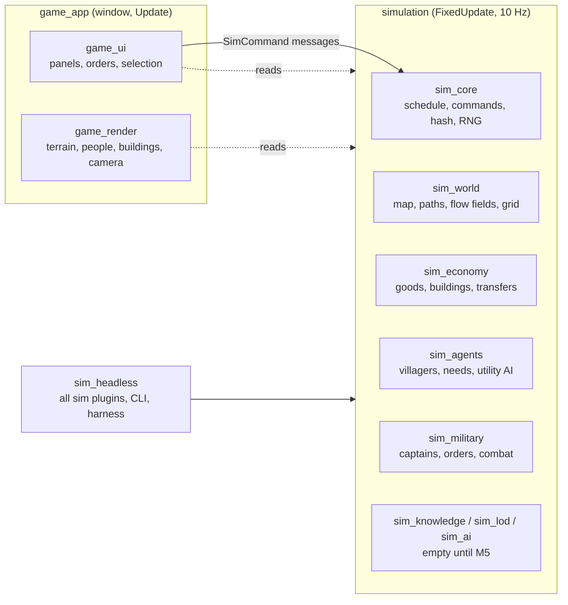

# Architecture

How the code is organised and how one tick flows through it. The spec is [SEED.md](../SEED.md), and the reasons behind each decision are in the [ADRs](../adr).

## The big picture

There are two halves, and one rule between them ([ADR 0002](../adr/0002-workspace-and-sim-render-split.md)):
- **The simulation** (`sim_*` crates) changes state only in Bevy's `FixedUpdate` schedule, at 10 ticks per game-second. It never depends on rendering, windowing, audio or asset crates, so it runs headless, in tests and in the game alike.
- **The game** (`game_*` crates) runs in `Update`. It **only reads** sim state, never writes it, not even a marker component. Player input reaches the sim only as `SimCommand` messages.

## Crates

| Crate | What it owns | Depends on |
| --- | --- | --- |
| `sim_core` | The tick schedule (`SimSet`) and the run gate, `SimTick`, the calendar and game hours, seeded RNG streams, `SpawnId`, `FactionId` constants, the command path and replays, the state hash and its registry, the name table; for M4 runs: `RunState`, `RunConfig` and `Offers` (`run.rs`), `SimEvent`, `Chronicle` (with battle reports) and `EventFeed` (`events.rs`), `FactionModifiers` (`modifiers.rs`); saves (`save.rs`: `SaveState`, `AppSaveExt`, `save_world`, `load_world`, GP-12) | Bevy ECS, postcard, zstd |
| `sim_world` | `WorldMap` (terrain arrays in 64-tile chunks, regions), world generation and its presets (`WorldPreset`: developed and run), `Settlement`, roads, A* paths and `PathCache`, flow fields and `FlowCache`, `SpatialGrid`; for M4 runs: settlement sizes (`SettlementSize`, `worldgen/sizes.rs`) and monuments (`Monument`, `monuments.rs`, placed by `worldgen/monuments.rs`) | `sim_core` |
| `sim_economy` | Goods, recipes and workplaces (`economy.ron`, with the run-only `haul` block, `HaulData`), `Stockpile`, `Inventory`, `Transfers` and the transfer resolver, buildings and settlement layout (`layout_recipe`, the layout's alternation; `set_recipe`, which the Forge edict and ordered smithies call; SIM-64) | `sim_core`, `sim_world` |
| `sim_agents` | Villagers: population, needs, the utility AI (`decide`), actions (`perform`), walking, food security, reactions to armies (flee, hide, fight), combat components; for M4: settlement standing (`Owner`, `Goodwill`, `set_owner`, the goodwill ledger and its spread: `GoodwillLedger`, `apply_goodwill`, `standing.rs`) and loyalty (`Loyalty`, `SettlementLoyalty`, `loyalty.rs`); the owner's `FactionModifiers` where villagers work (`act.rs`: `FoodYield` outputs via `yield_units`, `SmithSpeed` cycles via `smith_ticks`, for economy.ron recipes tagged with a `modifier`); M4a step 4 (GP-34): moving villagers between trades (`jobs.rs`: `reassign` and `reassign_to` follow populate's rule, `nearest_with_room`, `occupation_at`, `movable`; called only from sim_military's serial `govern::step`), and the edicts' reads at the point of use (`Rationed` in `update_needs`, `update_food_security` and `perform`, via `act::rationed_ticks`; `Mustered` and the feast in `ai::decide`) | `sim_core`, `sim_world`, `sim_economy` |
| `sim_military` | `army.ron`, captains and order queues, followers, command validation, the logistics step, army index and fighter grid, soldier AI, crowd steering, combat, morale, upkeep, threat, scripted raiders, army spawning, veterans (`veterans.rs`: `Veteran` on every soldier, battles ended by the hourly `end_battles`, rank gains read in `resolve_strikes` and `soldier_upkeep`; SIM-36); conquest, garrisons and revolts (`conquest.rs`: `owner_of`, `transfer`, `militia_or_foes_near`, `revolts`; in the `orders.rs` logistics step: the `Attack` hold (`attack`; in a run a player captain at Aggressive sacks the town there, `sack`, M4a step 5), the `Demand` parley (`demand`: an hour at the gate, then `tenure::parley`'s comparison; M4a step 5), owned-village supply (`supply`, from `forage` and `gather_food`), the `Garrison` order (`validate_spec`, `step_order`)); band life: the `Give` order (`give`), goodwill deeds posted to the ledger (`goodwill_deed`), wild food and the `Forage` order (`wild.rs`: `WildFood`, `harvest`, `regrow`), village requests (`requests.rs`: `RequestBoard`, `step`, `delivered` credited from the `Give` arm), invitations (`invitations.rs`: `step`, `answer`), the band for hire of the Sellswords run modifier (`sellswords.rs`: `setup` at the end of run setup, hired or sent away from `choose`, lapsed in `invitations::step`'s expiry pass; GP-27), drifters (`drifters.rs`: `draw`) and `enlist_into`, the bookkeeping every way of joining an army shares; monuments (`monuments.rs`: `Holder`, guard camps with `Guard` and `NoUpkeep` spawned at run setup, the hourly `hold`; clear-the-camp requests in `requests.rs`); runs (`progression`, `progression.ron`): the start draws, `setup_run`, the champion (`progression/champion.rs`: `ChampionRank`, points `credit`ed where deeds happen, hourly `rank_ups` with trait offers, succession in `fallen`; SIM-34, SIM-35), offers (`ChooseOffer`) and abandoning, the hourly `progress` driver, dominion boons and captain slots (`progression/dominion.rs`: `tally`, `captain_slots`, checked in `orders.rs` `appoint`; GP-24, GP-25) and `rebuild_modifiers` (the only writer of `FactionModifiers`, GP-23), whose multipliers are read in `soldier_upkeep` (morale, desertion), `resolve_strikes` (attack, defence, and the rival seat's defence bonus), `recruit` (recruit chance), `veterans::end_battles` (veteran rate), `move_captains` and `move_soldiers` (march speed), `barter` (trade value) and `update_threats` (threat radius); the rival warlord (`rival.rs`: `RivalState`, its lands and seat garrison at run setup, the hourly `clock` with levies via `enlist_into`, the seat's defence bonus and raids split off the garrison with `orders::split_army`, and `think`, which steers the raiding bands (`RivalBand`); GP-28) and the pacing director (`director.rs`, `director.ron`: `DirectorData`, `Director`, the hourly `step` that measures tension and brings raider bands; GP-16); battle reports (written by `end_battles` from `Captain.battle_foes`/`battle_kills` set in `resolve_strikes` and `battle_rout` seen in `build_index`) and the chronicle in words and the run summary (`chronicle.rs`: `describe`, `RunSummary`; UI-09); saves (`save.rs`: every type registered saved, plus the army index and fighter grid); Lordship (M4a, ADR 0020): tenure and the loyalty terms (`tenure.rs`: `Tenure`, `record_taking` from `transfer_seeded`, the hourly `step`), influence (`influence.rs`: `Influence`, the pure `power`, `pull` and `field_at`, the hourly `step`, `contest_term`; envoys in `invitations::step`, the sphere's ease in `drifters::draw`, `Feat::Realm`; GP-31), governing (`govern.rs`: `Steward`, edicts', stewards', market and buildings data; M4a step 4, GP-34: the `Govern` command (`command`, validated by `refusal`), `step` with the pending dials, waves, feast and the reset of a lost town, the loyalty terms `dues_term` and `table_term`, `build_speed`, `levy_sizes`, `wave_size`, `mustered`, and the read-only forecasts `work_forecast`, `dues_forecast`, `table_forecast` and `lock_left` that the panel prints; in `orders.rs`: `lands`, the tithe and levy pass, with `collector` and `store_arms`) and fallout (`fallout.rs`: `Fallout`), progress slots 13-16 | `sim_core`, `sim_world`, `sim_economy`, `sim_agents` |
| `sim_knowledge`, `sim_lod`, `sim_ai` | Placeholders for M5: faction knowledge, simulation LOD, rival warlords | `sim_core` |
| `sim_headless` | `SimPlugins` (every sim plugin in order; `SimPlugins::run` for a run), `HeadlessConfig` and scenarios (`set_up_scenario`, shared with `game_app`), the run/record/verify harness, stats, the scripted player (`bot.rs`: `Bot`, `run_bot`, `play_bot`, `play_bot_with`; `--bot`; it plays to win, M4 step 11) and the headless fast-forward (`step_until_event`), saves (`load_app`, `save_app`, `continue_run`, `resume_commands`; `SimPlugins.generate`), the CLI (`--run`, `--difficulty`, `--bot`, `--save`, `--load`, `--chronicle`, `--workshops`: smithies, mines and the island's weapons and tools, `stats::workshops` and `stats::census`, SIM-64), benchmarks (`tick/run_island` among them) | every `sim_*` crate |
| `game_render` | Terrain chunks, buildings, people (detail bands, interpolation), banners, procedural art, the camera rig; for M4: monument landmarks with holder pennants (`monuments.rs`), terrain overlays (`overlay.rs`, O; the M4a influence mode, `overlay/influence.rs`: a coarse share grid, the front, dashed sphere edges and invitation rings, computed render-side from each town's `Influence`), `WorldEpoch` cache clearing and the `InputGate` | `sim_*` (read-only) |
| `game_ui` | Time bar, selection, villager/soldier inspector, settlement panel, captain panel and orders, labels, dev debug panel (egui); for M4: the `UiScreen` state with the new-game and end screens (`screens.rs`), offer cards (`cards.rs`), the run bar (`run_bar.rs`), the event feed with auto-pause and fast-forward (`feed.rs`: the chronicle's sentences and the military log), monument tooltips (`tooltip.rs`), save requests, the resume list and the notice line (`saves.rs`); for M4a the settlement panel's "Why they feel this way" section (`panels/why.rs`, UI-11: the tenure line, the loyalty target term by term, goodwill and the dated deed log, the revolt risk; pure text built from state `settlement_panel` copies out, using sim_agents' `loyalty_parts`, `loyalty_pulls` and `deciding_term`) | `sim_*`, `game_render` |
| `game_app` | The binary: window, plugins, start scenario (through `sim_headless::set_up_scenario`; a run by default, `--skirmish`, `--villages`, `--stress n`), saves (`saves.rs`: one slot per run, F5/F9, save on exit, resume, loads into the running world), new runs (built on a worker thread and loaded in place; restarts itself only if that fails), stress mode | everything |

`tests/` is the `integration_tests` crate: the scenario and determinism tests.

Each crate exposes **one plugin** that registers its resources, components (in the state hash), system sets and systems. `SimPlugins` (in `sim_headless`) adds them in dependency order: Core, World, Economy, Agents, Military, Knowledge, Lod, Ai.

## One tick

`FixedUpdate` runs nine chained `SimSet`s ([sim_core/src/schedule.rs](../../crates/sim_core/src/schedule.rs)). Inside each set, systems run in parallel where their data access allows; where order matters, it is explicit.

**The run gate.** Every `SimSet` runs only while `run_in_progress` holds: there is no run (`RunState.config` is `None`, as in the developed world), or the run hasn't ended. A serial step ends a run with `RunState::finish`, which only records a pending outcome; `settle_outcome` makes it final at the end of that tick. The ending tick completes, and from the next one every tick does nothing, so `SimTick` and the state hash freeze (GP-21).

| # | `SimSet` | Systems, in order | Notes |
| --- | --- | --- | --- |
| 1 | **Input** | **Start** (tick 0 of a run only): `report_start` (sim_military, `MilitarySet::Start`) **Inject:** `inject_scripted`, `record_commands` (sim_core) **Ai:** the sim's own AI writes `SimCommand::ai` here: `raiders::think`, then `rival::think` (sim_military, chained) **Consume:** `drain_commands` (sim_core); `MilitarySet::Orders`: `collect_commands`, then `apply_commands`, then `run_orders` (in a run it ends with `orders::lands`, M4a step 4, GP-34: on the tick after each game hour, tithes and levies go to the nearest player captain within `edicts.reach`, in the hour a dial is set and then daily) | The run's start and its offers are told from state on its first tick, so a save before it keeps them. Chained Inject, Ai, Consume, so commands arrive in a fixed order. Commands become order-queue changes; captains progress orders and do settlement dealings (the serial logistics step). M4a step 5: a `Demand` parleys for `demand.parley_hours` within `recruit.radius`, then the town kneels (`transfer_seeded`, `Cause::Submission`) or refuses (a Threat deed, the cooldown); an `Attack` held at Aggressive by a player captain in a run sacks the storehouse before the town changes hands (`Cause::Sack`); a `Give` in a run courts the town (`tenure::gift`, `Deed::Gift`) |
| 2 | **Knowledge** | `MilitarySet::Index`: `build_index`, then `update_threats` | Builds read-only summaries (army index, fighter grid) for this tick's parallel systems; sets each settlement's `Threat` (in a run, `update_threats` multiplies the radius by `edicts.walls_threat` at a player town under Walls, M4a step 4) |
| 3 | **Decide** | `AgentSet::Decide`: `ai::decide`; then `MilitarySet::Decide`: `soldiers::decide` | Villagers score options (about a tenth each tick); soldiers choose follow, fight or rout and aim blows. In a run with economy.ron `haul.run_fixes` (SIM-64, the run-only branches): `decide` first lists the input deliveries haulers are on (`ai::RunFixes`, read-only), scores with the smithy-chain fixes (`work_state_fixed`, capped and claimed deliveries, `min_load`, `cycle_hold`), and after the parallel pass sends back, in SpawnId order, carters who took the same free delivery in the same tick. M4a step 4 (GP-34, run only): `decide` reads `Mustered` and the settlement's `Edicts` feast: a mustered villager never works and idles on the green (the settlement's centre), and during a feast work scores are multiplied by `edicts.feast.work` and idlers gather on the green; with the run fixes, an exhausted villager (rest at or below 0.1, no cycle under way) naps instead of scoring work he cannot start |
| 4 | **Move** | `AgentSet::Move`: `plan_paths`, then `move_agents`; then `MilitarySet::Move`: `move_captains`, then `move_soldiers` | Villagers follow A* paths; armies follow flow fields with separation |
| 5 | **Act** | `EconomySet::Post`: `act::perform`, `upkeep::eat`; then `EconomySet::Resolve`: `resolve_transfers`; then `MilitarySet::Combat`: `resolve_strikes`, then `find_fallen`, then `casualties` | Agents post transfer orders; the resolver applies them in SpawnId order (in a run with `haul.run_fixes`, `perform` caps an input delivery at its pickup with `act::input_cap`, empties hands into the storehouse before an input pickup or a food fetch, and ends a work cycle start whose hands `act::blocking_good` finds too full); blows and deaths resolve serially. `find_fallen` lists the grid's dead and the enlisted who starved (G4), in SpawnId order; a militiaman's death costs his settlement goodwill toward the faction he fought. M4a step 4 (GP-34): `perform` lengthens a `Rationed` villager's work cycle by `edicts.ration.work` (`act::rationed_ticks`); `resolve_strikes` adds `edicts.walls_defence` to the defence of a Walls town's militia within `garrison.radius` of its centre (`combat::WallsParam`). A landed blow marks both sides as having fought and keeps both armies in battle (SIM-36); a veteran's rank adds attack and defence there. When the champion falls, `casualties` settles the succession (SIM-35: `champion::fallen`, before its army passes to an heir) or ends the run lost |
| 6 | **Needs** | `AgentSet::Needs`: `update_needs` (hunger rises `Rationed.hunger` times as fast, M4a step 4), `update_food_security` (a rationed settlement's day of need is times its `Rationed.hunger`); then `AgentSet::Standing`: `apply_goodwill` (when the goodwill ledger has entries; in a run it also writes each settlement's dated `DeedLog`, M4a), then `drift_loyalty` (in a run its target carries the settlement's `LoyaltyTerms` as `bias`, M4a), then `aggregate_loyalty` (both daily); then `MilitarySet::Upkeep`: `soldier_upkeep`, `civilian_morale`, `tally`, `apply_desertions`; then `MilitarySet::Progress`: `progression::progress` (hourly, exclusive), which calls `veterans::end_battles` (every preset; ranks only in a run), `monuments::hold` (monuments exist only in a run), `conquest::revolts` (daily), then `wild::regrow` (daily, once wild food exists), then, in a run only, `drifters::draw` (daily), `requests::step`, `invitations::step`, `dominion::tally` and `champion::rank_ups`, then `rebuild_modifiers`, then (in a run) `dominion::refresh_slots`, `rival::clock` and `director::step`, then M4a's run-only slots (ADR 0020): 13 `influence::step` (the field hourly; on the day tick influence deeds, the envoy flags and the realm's rank credit, M4a step 3), 14 `tenure::step`, 15 `govern::step` (step 4, GP-34: pending dials applied hourly with the first wave, the feast's end, the dawn waves of Work and Levy, the ration, the reset of a lost town's edicts and the soldiers' sweep of `Mustered` and `Rationed`; sites and stewards follow in steps 8 and 9) and 16 `fallout::step` (a stub until step 6) | Hunger, rest, safety; this tick's goodwill changes and their spread to nearby settlements are applied (GP-22, before the drift reads goodwill); once a day loyalty drifts toward its target and each settlement's mean, minimum and unrest clock are refreshed (GP-06, SIM-24); then morale, starvation and desertion. Upkeep runs after Standing because desertions change who is enlisted. Last, the hourly progress driver runs settlement-level steps in a fixed order. First, armies that have landed or taken no blow for `veterans.quiet_hours` end their battle (SIM-36): those who fought count it and, in a run, rank up, and a `Battle` is reported. Then revolts, which read the day's loyalty summary (GP-06), the daily regrowth of wild food (SIM-38), and in a run the band-life steps (GP-22): drifters join player bands near liked settlements, settlements post, complete and expire requests (paying rewards from their real stocks), then liked settlements with a player captain near offer lordship (in a run, also an independent town `influence::step` flagged at dawn as sending envoys, with no captain near, in the hours after the day tick (on the day tick itself slot 7 reads no flag: yesterday's are stale until slot 13 sets the new day's): at most `influence.max_envoys_per_day` a day, M4a), lapsed invitations start their cooldown and a lapsed hire's sellswords leave (GP-27). Monuments change hands first (GP-23: one faction's soldiers alone at one for `monuments.hold_hours`, or drift back to nobody), so this hour's requests see which guard camps remain (clear-the-camp requests); the last step rebuilds `FactionModifiers` from held monuments, boons, champions' traits and run modifiers, which the systems of the next tick read. Just before it, in a run, the dominion tally (GP-24) sums each region's people held by the player and posts a dominion boon offer the first time a share threshold is reached, and the champion ranks up for the points its deeds earned (SIM-35), with an offer of three traits per rank; just after it, the player's captain slots (GP-25), which read the rebuilt `CaptainSlots` modifier, are stored for the UI. Then the rival's clock (GP-28) sets its seat's defence bonus and levies and raids when due, and the pacing director (GP-16) measures the player's tension and brings a raider band when the run is about to go quiet, its first event is due, or tension is low. Last come Lordship's four slots (M4a, run only, each in its own span): influence (GP-31: every run town's `Influence`, its power and the player's and the rival's shares from the pure `influence::field_at`; then on the day tick a no-spread `Deed::Influence` at towns the player doesn't own, the envoy flags that slot 7 reads the next hours, and the champion's `Feat::Realm` credit; the drifters of slot 5 read the previous hour's field for the sphere's ease), tenure (first `Deed::Defended` from the hour's battle reports (GP-32, M4a step 5: a player army's kill against raiders or the rival near an independent or player town, never against bandits from that town); then per town it fades scars on the day tick, keeps a submitted town's watch (the hour counted if watched by your strength, a garrisoned town of yours or your other towns' influence; on the day tick the day just ended judged, a defiance after two weak days, the tribute held at Tithe, settling after `demand.settle_days`), and rebuilds its `LoyaltyTerms` from its `Tenure` (Resentment, Stirred, Awe while watched, Bond) and the terms `influence.rs` and `govern.rs` expose, so the next day's drift reads them), govern (edicts, M4a step 4; sites and stewards later) and fallout (bandits rise, the rival vows reprisals, which the clock reads the next hour) |
| 7 | **Aggregate** | (empty until M5) | Dormant regions |
| 8 | **Lod** | (empty until M5) | Promotion and demotion |
| 9 | **Bookkeeping** | `refresh_chunk_digests`, `rebuild_grid` (sim_world); `BookkeepingSet::Record`: `record_events`, then `settle_outcome` (sim_core); then `BookkeepingSet::Advance`: `advance_tick` (sim_core) | The spatial grid is rebuilt for the next tick; this tick's `SimEvent`s are sorted into the event feed and the chronicle; a pending run outcome becomes final; the tick counter advances last |

`sim_core::timing` adds marker systems between the sets to measure each set's wall time (`SimTimings`). The debug panel and `sim_headless --timings` show them.

**Exclusive systems** (`fn(&mut World)`) are used only for rare serial steps: applying commands, running orders, casualties and desertions, and the progress driver. Most run only when there is work (`run_if`), because each one forces a sync point. The exception is `progression::progress` (`MilitarySet::Progress`, M4), which is gated by `on_hour`: it runs once per game hour (100 ticks) in every preset, and its sub-steps return early when they have nothing to do (daily ones check `Calendar::on_day`). Settlement- and run-level steps go into this driver rather than getting their own exclusive system.

## The game's frame (Update)

The game side runs in `Update` in named sets, chained:

| Set | Systems |
| --- | --- |
| `RenderSet::Epoch` (game_render) | When `WorldEpoch` changes: `terrain::clear_chunks`, `setup_ocean`, `buildings::clear_buildings`, `monuments::clear_monuments` |
| `RenderSet::Overlay` (game_render) | `overlay::overlay_keys` (O), `compute_overlay` (twice a second, every two seconds in the influence mode, which builds `overlay::influence::InfluenceView` from the towns' `Influence`; bumps `Overlay.generation` only on quantised colour changes, so a ring filling never rebuilds terrain), `monument_rings`, `influence_marks` (the influence mode's dashed sphere edges and rings, gizmos along the terrain) |
| `RenderSet::World` (game_render) | `sync_chunks` (a chunk rebuilds when its map revision or its overlay signature changes), `swap_chunk_materials`, `spawn_buildings`, `swap_building_materials`, `spawn_monuments`, `update_pennants`, the camera (`rig_input` and `jump_to_settlement` only while the `InputGate` is open, then `apply_rig`) |
| `AppSet::Saves` (game_app, before `RenderSet::Epoch` and `UiSet::Screens`) | `saves::handle_saves` (exclusive, between ticks): F5/F9 and "Resume" (`SaveRequest`), a `NewRunRequest` (its island built on a worker thread with `sim_headless::headless_app`, then loaded), every load through `sim_core::load_world` into the running world, then `WorldEpoch` bumped, the clock paused and `OpeningShot` set again |
| `UiSet::Screens` (game_ui) | When `WorldEpoch` changes: `cards::forget_sent`, `run_bar::close_offer`. `screens::choose_screen` (after a new epoch it closes any screen and decides again; the new-game screen on a run's first frame, paused at tick 0; the end screen once `RunState.outcome` is set), `gate_input` |
| `UiSet::Hud` (game_ui) | The time bar (`speed_keys` only while `playing`), selection (`pick` only while `playing`), labels, panels, the captain panel and orders (`right_click`, `hotkeys` only while `playing`), the new-game and end screens' buttons, seed typing, `resume_buttons` and `scroll_timeline`, offer cards (`choice_buttons`; `SentOffers` hides an answered offer only until the tick that applies the answer has run, so one the sim refused, such as a hire the champion can't make yet, shows again), the run bar (`update_run_bar`, `offer_buttons`, `bar_buttons`, `draw_card_popup`), the feed (`read_feed`, exclusive: new `EventFeed` entries told by `sim_military::describe_entries` and `MilitaryLog` lines merged by tick, auto-pause; then `show_feed`, `click_feed`), saves (`quick_keys`: F5/F9; `show_notice`), monument tooltips (`hover`, `show_tooltip`) |
| `AppSet::Game` (game_app) | `frame_start` (when `OpeningShot` changes), `stress_log` |
| `AppSet::Saves` in `Last` (game_app, after Bevy's `ExitSystems`) | `saves::save_on_exit`: on `AppExit`, a run that has started and isn't over is saved to its slot; a finished run's slot is deleted |

`OnEnter`/`OnExit` of `UiScreen::NewGame` and `UiScreen::Ended` spawn and despawn the full-screen screens (`OnEnter(Ended)` runs `write_end_report`, exclusive: `sim_military::run_summary` and the chronicle described, then `spawn_end`). Agents and the older render systems run unordered in `Update` as before. None of these write sim state: choices go out as `SimCommand`s through `army::send` (`ChooseOffer`, `AbandonRun`, orders).

## From a click to a frame

1. **Click.** In `Update`, `game_ui::army::right_click` turns a right-click into `SimCommand::player(FactionId::PLAYER, IssueOrder { captain, order: MoveTo { .. }, .. })` and writes it as a Bevy message.
2. **Record.** On the next fixed tick, `record_commands` logs it (only player commands go into replays), and `drain_commands` counts it.
3. **Validate.** `collect_commands` and `apply_commands` check it (is it the issuer's captain? is the target valid?) and update the captain's `orders`.
4. **Plan.** `run_orders` sets the captain's goal and makes sure its flow field and rally field exist (`FlowCache`).
5. **Steer.** `build_index` exposes those fields to soldiers. `move_captains` and `move_soldiers` move everyone.
6. **Draw.** In `Update`, `game_render::agents` snapshots positions before each tick (`FixedFirst`) and interpolates between the last two ticks ([ADR 0008](../adr/0008-agent-rendering-and-interpolation.md)), so motion is smooth at any speed.

## Where state lives

- **Components on sim entities.** Every sim entity has a `SpawnId`: villagers, soldiers, buildings, settlements. These are **hashed** (the state hash covers them) unless explicitly exempt.
- **Resources.** Data loaded from `assets/data/*.ron` (`Villagers`, `Economy`, `Army`, `Progression`, `Calendar`, `WorldGenSettings`) and world-level state (`WorldMap`, `Factions`, `ArmyStats`, `SimTick`) are hashed.
- **Standing and loyalty (M4).** Every populated settlement has an `Owner`, a `Goodwill` vector and a `SettlementLoyalty` summary next to its `SettlementEconomy`, and every villager a `Loyalty`, in all presets. A settlement changes hands only through `sim_agents::set_owner`, which sim_military calls through `conquest::transfer` (conquest, revolt, and accepted invitations) ([ADR 0014](../adr/0014-ownership-conquest-and-loyalty.md)). Goodwill changes only through the hashed `GoodwillLedger`: deeds post to it from serial steps (the logistics step, casualties, offers), and `apply_goodwill` sorts it, adds each change and its spread, and clears it.
- **Run state (M4).** `RunState` (config, outcome), `Offers`, `Chronicle` and `FactionModifiers` in sim_core, and `RunProgress` in sim_military, are always present and hashed, with defaults outside a run, so the coverage test sees them from tick 0 ([ADR 0013](../adr/0013-runs-presets-and-run-config.md)). `RunProgress` also carries the hourly dominion tally per region (with its never-cleared threshold flags) and the player's captain slots (GP-24, GP-25). `RequestBoard` (open requests, per-settlement samples and cooldowns) is likewise always present and hashed, empty outside a run. Every monument carries a hashed `Holder` from run setup; guard camps' members carry hashed `Guard` and `NoUpkeep` markers. A band for hire (the Sellswords run modifier, GP-27) is an ordinary army of `FactionId::INDEPENDENT` whose members carry `NoUpkeep`, named by its pending `Hire` offer: nothing else records it. It is the only faction-0 army, so `update_threats` skips faction 0 and `soldier_upkeep` spares an independent `NoUpkeep` soldier the casualty shock. Every soldier and captain carries a hashed `Veteran` from enlistment (removed on desertion), and each `Captain` its army's battle state; the champion carries a hashed `ChampionRank` beside `Champion` and `Traits`, all three moved together on succession. `RivalState` and the director's `Director` are always present and hashed (defaults outside a run); the rival's raiding bands carry a hashed `RivalBand` (passed to the heir when their captain falls), and a raider band's director target is in its hashed `Raider`. `FactionModifiers` is rebuilt from that state every game hour and never edited elsewhere ([ADR 0015](../adr/0015-monuments-and-faction-modifiers.md)). `EventFeed` is a UI ring derived from events and is exempt. The `Chronicle` also holds a `BattleReport` per battle ([ADR 0017](../adr/0017-events-and-chronicle.md)).
- **Lordship (M4a, [ADR 0020](../adr/0020-lordship.md)).** Run setup (`setup_run`, before the rival's grant) puts on every populated settlement of a run a `Tenure` (how it was taken: `Native`, the rival's lands `Granted`), an `Influence`, `LoyaltyTerms`, a `DeedLog` and `Edicts`, all hashed and saved and absent in every other preset; `Fallout` is always present (empty outside a run). `transfer_seeded` writes `Tenure` from the cause (and maps causes to event kinds: a sack is a `Conquest`, a submission `Submitted`, a subversion `Subverted`, a defiance `Defied`); militia deaths count in `Tenure.blood` for the faction they fought (`Tenure::spill`; a taking reads only its taker's); a taking refreshes the influence field (`influence::refresh_field`, so the town's power counts for its new owner) and rebuilds the town's `LoyaltyTerms` at once (`tenure::rebuild_terms`), and `tenure::step` rebuilds them hourly, the Contest term from `influence::contest_term` (step 3). `Agent` (sim_agents), `Rationed`, `Mustered`, `Assignment`, `Specialty`, `Construction` (sim_economy), `Bandits` and `Steward` are registered and saved with no instance until their steps. `Veteran.trade` is written by `enlist` in every preset and read only for stewards (state hashes change everywhere; behaviour and stdout don't). `RivalState` gains `realm` (recorded at setup, the seat left out), `reprisal` and `last_reprisal`; `RivalBand` gains `pinned`.
- **Saves (M4, GP-12).** Every hashed type is also saved (`register_saved`); the event feed, the military log, the army index and the fighter grid are saved too, and decision traces by presence. The map is regenerated from the seed on load; caches start empty and the spatial grid is rebuilt by load hooks ([ADR 0016](../adr/0016-save-format.md)).
- **Caches and indexes.** `PathCache`, `FlowCache`, `SpatialGrid`, `ArmyIndex` and `FighterGrid` are exempt from the hash. Each is a pure function of hashed state and is rebuilt identically, so it can never change an outcome.
- **Render-side state.** Lives in render resources keyed by sim `Entity` (`AgentVisuals`, `Banners`), never on sim entities.
- **Game data.** Everything tunable lives in `assets/data/`, embedded at compile time with `include_str!`. [DATA.md](DATA.md) documents every field.

## Conventions
- Every system opens a tracing span: `let _span = tracing::info_span!("crate::system").entered();` (for Tracy).
- Every system lives in a named set. Use the crate's set enum (`AgentSet`, `EconomySet`, `MilitarySet`) to order across crates.
- Bevy system functions take many parameters, so `#[allow(clippy::too_many_arguments)] // Bevy system parameters.` is normal.
- Requirement IDs (GP-, SIM-, RND-, UI-, NFR-) appear in doc comments, tests and commits.
- Determinism rules: [DETERMINISM.md](DETERMINISM.md).
