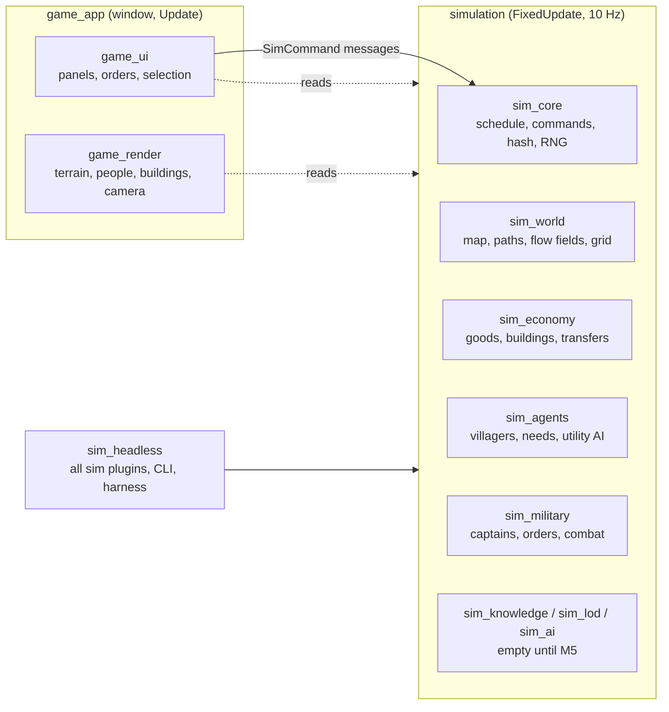

# Architecture

How the code is organised and how one tick flows through it. The spec is [SEED.md](../SEED.md), and the reasons behind each decision are in the [ADRs](../adr).

## The big picture

There are two halves, and one rule between them ([ADR 0002](../adr/0002-workspace-and-sim-render-split.md)):
- **The simulation** (`sim_*` crates) changes state only in Bevy's `FixedUpdate` schedule, at 10 ticks per game-second. It never depends on rendering, windowing, audio or asset crates, so it runs headless, in tests and in the game alike.
- **The game** (`game_*` crates) runs in `Update`. It **only reads** sim state, never writes it, not even a marker component. Player input reaches the sim only as `SimCommand` messages.

## Crates

| Crate | What it owns | Depends on |
| --- | --- | --- |
| `sim_core` | The tick schedule (`SimSet`) and the run gate, `SimTick`, the calendar and game hours, seeded RNG streams, `SpawnId`, `FactionId` constants, the command path and replays, the state hash and its registry, the name table; for M4 runs: `RunState`, `RunConfig` and `Offers` (`run.rs`), `SimEvent`, `Chronicle` and `EventFeed` (`events.rs`), `FactionModifiers` (`modifiers.rs`) | Bevy ECS only |
| `sim_world` | `WorldMap` (terrain arrays in 64-tile chunks, regions), world generation and its presets (`WorldPreset`: developed and run), `Settlement`, roads, A* paths and `PathCache`, flow fields and `FlowCache`, `SpatialGrid`; for M4 runs: settlement sizes (`SettlementSize`, `worldgen/sizes.rs`) and monuments (`Monument`, `monuments.rs`, placed by `worldgen/monuments.rs`) | `sim_core` |
| `sim_economy` | Goods, recipes and workplaces (`economy.ron`), `Stockpile`, `Inventory`, `Transfers` and the transfer resolver, buildings and settlement layout | `sim_core`, `sim_world` |
| `sim_agents` | Villagers: population, needs, the utility AI (`decide`), actions (`perform`), walking, food security, reactions to armies (flee, hide, fight), combat components; for M4: settlement standing (`Owner`, `Goodwill`, `set_owner`, the goodwill ledger and its spread: `GoodwillLedger`, `apply_goodwill`, `standing.rs`) and loyalty (`Loyalty`, `SettlementLoyalty`, `loyalty.rs`); the owner's `FactionModifiers` where villagers work (`act.rs`: `FoodYield` outputs via `yield_units`, `SmithSpeed` cycles via `smith_ticks`, for economy.ron recipes tagged with a `modifier`) | `sim_core`, `sim_world`, `sim_economy` |
| `sim_military` | `army.ron`, captains and order queues, followers, command validation, the logistics step, army index and fighter grid, soldier AI, crowd steering, combat, morale, upkeep, threat, scripted raiders, army spawning; conquest, garrisons and revolts (`conquest.rs`: `owner_of`, `transfer`, `militia_or_foes_near`, `revolts`; in the `orders.rs` logistics step: the `Attack` hold (`attack`), owned-village supply (`supply`, from `forage` and `gather_food`), the `Garrison` order (`validate_spec`, `step_order`)); band life: the `Give` order (`give`), goodwill deeds posted to the ledger (`goodwill_deed`), wild food and the `Forage` order (`wild.rs`: `WildFood`, `harvest`, `regrow`), village requests (`requests.rs`: `RequestBoard`, `step`, `delivered` credited from the `Give` arm), invitations (`invitations.rs`: `step`, `answer`), drifters (`drifters.rs`: `draw`) and `enlist_into`, the bookkeeping every way of joining an army shares; monuments (`monuments.rs`: `Holder`, guard camps with `Guard` and `NoUpkeep` spawned at run setup, the hourly `hold`; clear-the-camp requests in `requests.rs`); runs (`progression`, `progression.ron`): the start draws, `setup_run`, the champion, offers (`ChooseOffer`) and abandoning, the hourly `progress` driver, dominion boons and captain slots (`progression/dominion.rs`: `tally`, `captain_slots`, checked in `orders.rs` `appoint`; GP-24, GP-25) and `rebuild_modifiers` (the only writer of `FactionModifiers`, GP-23), whose multipliers are read in `soldier_upkeep` (morale), `resolve_strikes` (attack, defence), `move_captains` and `move_soldiers` (march speed), `barter` (trade value) and `update_threats` (threat radius) | `sim_core`, `sim_world`, `sim_economy`, `sim_agents` |
| `sim_knowledge`, `sim_lod`, `sim_ai` | Placeholders for M5: faction knowledge, simulation LOD, rival warlords | `sim_core` |
| `sim_headless` | `SimPlugins` (every sim plugin in order; `SimPlugins::run` for a run), `HeadlessConfig` and scenarios (`set_up_scenario`, shared with `game_app`), the run/record/verify harness, stats, the CLI (`--run`, `--difficulty`), benchmarks | every `sim_*` crate |
| `game_render` | Terrain chunks, buildings, people (detail bands, interpolation), banners, procedural art, the camera rig | `sim_*` (read-only) |
| `game_ui` | Time bar, selection, villager/soldier inspector, settlement panel, captain panel and orders, labels, dev debug panel (egui) | `sim_*`, `game_render` |
| `game_app` | The binary: window, plugins, start scenario (through `sim_headless::set_up_scenario`; `--run` for a run), stress mode | everything |

`tests/` is the `integration_tests` crate: the scenario and determinism tests.

Each crate exposes **one plugin** that registers its resources, components (in the state hash), system sets and systems. `SimPlugins` (in `sim_headless`) adds them in dependency order: Core, World, Economy, Agents, Military, Knowledge, Lod, Ai.

## One tick

`FixedUpdate` runs nine chained `SimSet`s ([sim_core/src/schedule.rs](../../crates/sim_core/src/schedule.rs)). Inside each set, systems run in parallel where their data access allows; where order matters, it is explicit.

**The run gate.** Every `SimSet` runs only while `run_in_progress` holds: there is no run (`RunState.config` is `None`, as in the developed world), or the run hasn't ended. A serial step ends a run with `RunState::finish`, which only records a pending outcome; `settle_outcome` makes it final at the end of that tick. The ending tick completes, and from the next one every tick does nothing, so `SimTick` and the state hash freeze (GP-21).

| # | `SimSet` | Systems, in order | Notes |
| --- | --- | --- | --- |
| 1 | **Input** | **Inject:** `inject_scripted`, `record_commands` (sim_core) **Ai:** the sim's own AI writes `SimCommand::ai` here: `raiders::think` (sim_military; the rival joins in M4 step 7) **Consume:** `drain_commands` (sim_core); `MilitarySet::Orders`: `collect_commands`, then `apply_commands`, then `run_orders` | Chained Inject, Ai, Consume, so commands arrive in a fixed order. Commands become order-queue changes; captains progress orders and do settlement dealings (the serial logistics step) |
| 2 | **Knowledge** | `MilitarySet::Index`: `build_index`, then `update_threats` | Builds read-only summaries (army index, fighter grid) for this tick's parallel systems; sets each settlement's `Threat` |
| 3 | **Decide** | `AgentSet::Decide`: `ai::decide`; then `MilitarySet::Decide`: `soldiers::decide` | Villagers score options (about a tenth each tick); soldiers choose follow, fight or rout and aim blows |
| 4 | **Move** | `AgentSet::Move`: `plan_paths`, then `move_agents`; then `MilitarySet::Move`: `move_captains`, then `move_soldiers` | Villagers follow A* paths; armies follow flow fields with separation |
| 5 | **Act** | `EconomySet::Post`: `act::perform`, `upkeep::eat`; then `EconomySet::Resolve`: `resolve_transfers`; then `MilitarySet::Combat`: `resolve_strikes`, then `find_fallen`, then `casualties` | Agents post transfer orders; the resolver applies them in SpawnId order; blows and deaths resolve serially. `find_fallen` lists the grid's dead and the enlisted who starved (G4), in SpawnId order; a militiaman's death costs his settlement goodwill toward the faction he fought |
| 6 | **Needs** | `AgentSet::Needs`: `update_needs`, `update_food_security`; then `AgentSet::Standing`: `apply_goodwill` (when the goodwill ledger has entries), then `drift_loyalty`, then `aggregate_loyalty` (both daily); then `MilitarySet::Upkeep`: `soldier_upkeep`, `civilian_morale`, `tally`, `apply_desertions`; then `MilitarySet::Progress`: `progression::progress` (hourly, exclusive), which calls `monuments::hold` (monuments exist only in a run), `conquest::revolts` (daily), then `wild::regrow` (daily, once wild food exists), then, in a run only, `drifters::draw` (daily), `requests::step`, `invitations::step` and `dominion::tally`, then `rebuild_modifiers`, and last (in a run) `dominion::refresh_slots` | Hunger, rest, safety; this tick's goodwill changes and their spread to nearby settlements are applied (GP-22, before the drift reads goodwill); once a day loyalty drifts toward its target and each settlement's mean, minimum and unrest clock are refreshed (GP-06, SIM-24); then morale, starvation and desertion. Upkeep runs after Standing because desertions change who is enlisted. Last, the hourly progress driver runs settlement-level steps in a fixed order; today revolts, which read the day's loyalty summary (GP-06), the daily regrowth of wild food (SIM-38), and in a run the band-life steps (GP-22): drifters join player bands near liked settlements, settlements post, complete and expire requests (paying rewards from their real stocks), then liked settlements with a player captain near offer lordship and lapsed invitations start their cooldown. Monuments change hands first (GP-23: one faction's soldiers alone at one for `monuments.hold_hours`, or drift back to nobody), so this hour's requests see which guard camps remain (clear-the-camp requests); the last step rebuilds `FactionModifiers` from held monuments, boons, champions' traits and run modifiers, which the systems of the next tick read. Just before it, in a run, the dominion tally (GP-24) sums each region's people held by the player and posts a dominion boon offer the first time a share threshold is reached; just after it, the player's captain slots (GP-25), which read the rebuilt `CaptainSlots` modifier, are stored for the UI. Later M4 steps add veterans, the rival and the director |
| 7 | **Aggregate** | (empty until M5) | Dormant regions |
| 8 | **Lod** | (empty until M5) | Promotion and demotion |
| 9 | **Bookkeeping** | `refresh_chunk_digests`, `rebuild_grid` (sim_world); `BookkeepingSet::Record`: `record_events`, then `settle_outcome` (sim_core); then `BookkeepingSet::Advance`: `advance_tick` (sim_core) | The spatial grid is rebuilt for the next tick; this tick's `SimEvent`s are sorted into the event feed and the chronicle; a pending run outcome becomes final; the tick counter advances last |

`sim_core::timing` adds marker systems between the sets to measure each set's wall time (`SimTimings`). The debug panel and `sim_headless --timings` show them.

**Exclusive systems** (`fn(&mut World)`) are used only for rare serial steps: applying commands, running orders, casualties and desertions, and the progress driver. Most run only when there is work (`run_if`), because each one forces a sync point. The exception is `progression::progress` (`MilitarySet::Progress`, M4), which is gated by `on_hour`: it runs once per game hour (100 ticks) in every preset, and its sub-steps return early when they have nothing to do (daily ones check `Calendar::on_day`). Settlement- and run-level steps go into this driver rather than getting their own exclusive system.

## From a click to a frame

1. **Click.** In `Update`, `game_ui::army::right_click` turns a right-click into `SimCommand::player(FactionId::PLAYER, IssueOrder { captain, order: MoveTo { .. }, .. })` and writes it as a Bevy message.
2. **Record.** On the next fixed tick, `record_commands` logs it (only player commands go into replays), and `drain_commands` counts it.
3. **Validate.** `collect_commands` and `apply_commands` check it (is it the issuer's captain? is the target valid?) and update the captain's `orders`.
4. **Plan.** `run_orders` sets the captain's goal and makes sure its flow field and rally field exist (`FlowCache`).
5. **Steer.** `build_index` exposes those fields to soldiers. `move_captains` and `move_soldiers` move everyone.
6. **Draw.** In `Update`, `game_render::agents` snapshots positions before each tick (`FixedFirst`) and interpolates between the last two ticks ([ADR 0008](../adr/0008-agent-rendering-and-interpolation.md)), so motion is smooth at any speed.

## Where state lives

- **Components on sim entities.** Every sim entity has a `SpawnId`: villagers, soldiers, buildings, settlements. These are **hashed** (the state hash covers them) unless explicitly exempt.
- **Resources.** Data loaded from `assets/data/*.ron` (`Villagers`, `Economy`, `Army`, `Progression`, `Calendar`, `WorldGenSettings`) and world-level state (`WorldMap`, `Factions`, `ArmyStats`, `SimTick`) are hashed.
- **Standing and loyalty (M4).** Every populated settlement has an `Owner`, a `Goodwill` vector and a `SettlementLoyalty` summary next to its `SettlementEconomy`, and every villager a `Loyalty`, in all presets. A settlement changes hands only through `sim_agents::set_owner`, which sim_military calls through `conquest::transfer` (conquest, revolt, and accepted invitations) ([ADR 0014](../adr/0014-ownership-conquest-and-loyalty.md)). Goodwill changes only through the hashed `GoodwillLedger`: deeds post to it from serial steps (the logistics step, casualties, offers), and `apply_goodwill` sorts it, adds each change and its spread, and clears it.
- **Run state (M4).** `RunState` (config, outcome), `Offers`, `Chronicle` and `FactionModifiers` in sim_core, and `RunProgress` in sim_military, are always present and hashed, with defaults outside a run, so the coverage test sees them from tick 0 ([ADR 0013](../adr/0013-runs-presets-and-run-config.md)). `RunProgress` also carries the hourly dominion tally per region (with its never-cleared threshold flags) and the player's captain slots (GP-24, GP-25). `RequestBoard` (open requests, per-settlement samples and cooldowns) is likewise always present and hashed, empty outside a run. Every monument carries a hashed `Holder` from run setup; guard camps' members carry hashed `Guard` and `NoUpkeep` markers. `FactionModifiers` is rebuilt from that state every game hour and never edited elsewhere ([ADR 0015](../adr/0015-monuments-and-faction-modifiers.md)). `EventFeed` is a UI ring derived from events and is exempt.
- **Caches and indexes.** `PathCache`, `FlowCache`, `SpatialGrid`, `ArmyIndex` and `FighterGrid` are exempt from the hash. Each is a pure function of hashed state and is rebuilt identically, so it can never change an outcome.
- **Render-side state.** Lives in render resources keyed by sim `Entity` (`AgentVisuals`, `Banners`), never on sim entities.
- **Game data.** Everything tunable lives in `assets/data/`, embedded at compile time with `include_str!`. [DATA.md](DATA.md) documents every field.

## Conventions
- Every system opens a tracing span: `let _span = tracing::info_span!("crate::system").entered();` (for Tracy).
- Every system lives in a named set. Use the crate's set enum (`AgentSet`, `EconomySet`, `MilitarySet`) to order across crates.
- Bevy system functions take many parameters, so `#[allow(clippy::too_many_arguments)] // Bevy system parameters.` is normal.
- Requirement IDs (GP-, SIM-, RND-, UI-, NFR-) appear in doc comments, tests and commits.
- Determinism rules: [DETERMINISM.md](DETERMINISM.md).
