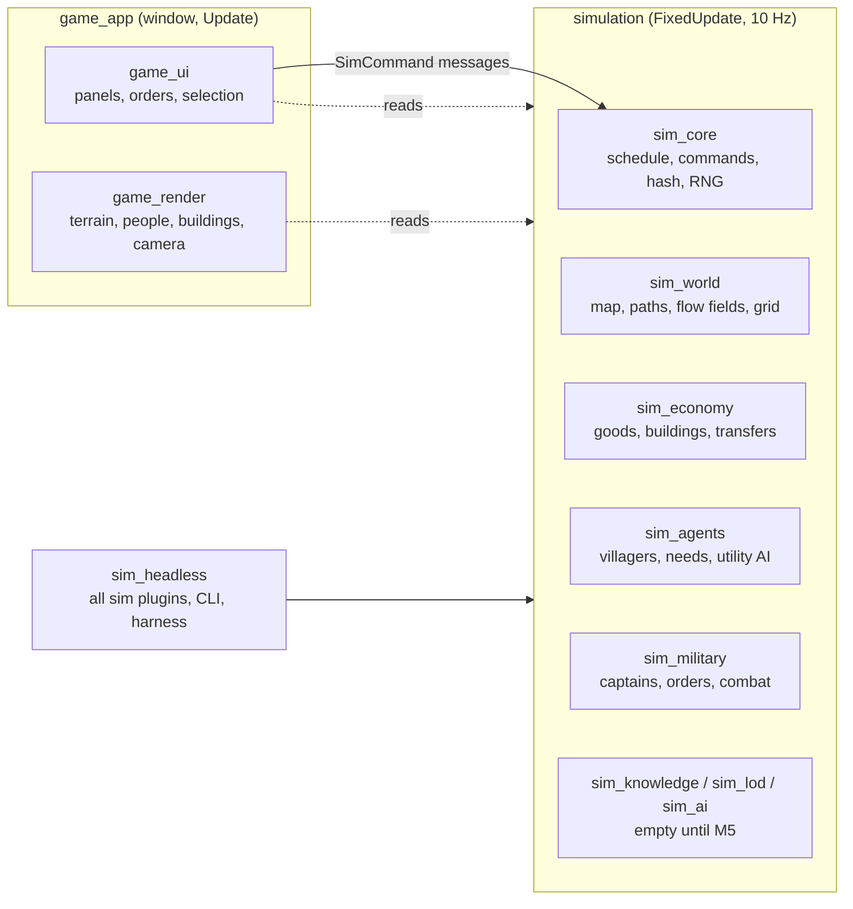

# Architecture

How the code is organised and how one tick flows through it. The spec is [SEED.md](../SEED.md), and the reasons behind each decision are in the [ADRs](../adr).

## The big picture

There are two halves, and one rule between them ([ADR 0002](../adr/0002-workspace-and-sim-render-split.md)):
- **The simulation** (`sim_*` crates) changes state only in Bevy's `FixedUpdate` schedule, at 10 ticks per game-second. It never depends on rendering, windowing, audio or asset crates, so it runs headless, in tests and in the game alike.
- **The game** (`game_*` crates) runs in `Update`. It **only reads** sim state, never writes it, not even a marker component. Player input reaches the sim only as `SimCommand` messages.

## Crates

| Crate | What it owns | Depends on |
| --- | --- | --- |
| `sim_core` | The tick schedule (`SimSet`), `SimTick`, the calendar, seeded RNG streams, `SpawnId`, the command path and replays, the state hash and its registry, the name table | Bevy ECS only |
| `sim_world` | `WorldMap` (terrain arrays in 64-tile chunks), world generation, `Settlement`, roads, A* paths and `PathCache`, flow fields and `FlowCache`, `SpatialGrid` | `sim_core` |
| `sim_economy` | Goods, recipes and workplaces (`economy.ron`), `Stockpile`, `Inventory`, `Transfers` and the transfer resolver, buildings and settlement layout | `sim_core`, `sim_world` |
| `sim_agents` | Villagers: population, needs, the utility AI (`decide`), actions (`perform`), walking, food security, reactions to armies (flee, hide, fight), combat components | `sim_core`, `sim_world`, `sim_economy` |
| `sim_military` | `army.ron`, captains and order queues, followers, command validation, the logistics step, army index and fighter grid, soldier AI, crowd steering, combat, morale, upkeep, threat, scripted raiders, army spawning | `sim_core`, `sim_world`, `sim_economy`, `sim_agents` |
| `sim_knowledge`, `sim_lod`, `sim_ai` | Placeholders for M5: faction knowledge, simulation LOD, rival warlords | `sim_core` |
| `sim_headless` | `SimPlugins` (every sim plugin in order), `HeadlessConfig` and scenarios, the run/record/verify harness, stats, the CLI, benchmarks | every `sim_*` crate |
| `game_render` | Terrain chunks, buildings, people (detail bands, interpolation), banners, procedural art, the camera rig | `sim_*` (read-only) |
| `game_ui` | Time bar, selection, villager/soldier inspector, settlement panel, captain panel and orders, labels, dev debug panel (egui) | `sim_*`, `game_render` |
| `game_app` | The binary: window, plugins, start scenario, stress mode | everything |

`tests/` is the `integration_tests` crate: the scenario and determinism tests.

Each crate exposes **one plugin** that registers its resources, components (in the state hash), system sets and systems. `SimPlugins` (in `sim_headless`) adds them in dependency order: Core, World, Economy, Agents, Military, Knowledge, Lod, Ai.

## One tick

`FixedUpdate` runs nine chained `SimSet`s ([sim_core/src/schedule.rs](../../crates/sim_core/src/schedule.rs)). Inside each set, systems run in parallel where their data access allows; where order matters, it is explicit.

| # | `SimSet` | Systems, in order | Notes |
| --- | --- | --- | --- |
| 1 | **Input** | **Inject:** `inject_scripted`, `record_commands` (sim_core), `raiders::think` (sim_military) **Consume:** `drain_commands` (sim_core); `MilitarySet::Orders`: `collect_commands`, then `apply_commands`, then `run_orders` | Commands become order-queue changes; captains progress orders and do settlement dealings (the serial logistics step) |
| 2 | **Knowledge** | `MilitarySet::Index`: `build_index`, then `update_threats` | Builds read-only summaries (army index, fighter grid) for this tick's parallel systems; sets each settlement's `Threat` |
| 3 | **Decide** | `AgentSet::Decide`: `ai::decide`; then `MilitarySet::Decide`: `soldiers::decide` | Villagers score options (about a tenth each tick); soldiers choose follow, fight or rout and aim blows |
| 4 | **Move** | `AgentSet::Move`: `plan_paths`, then `move_agents`; then `MilitarySet::Move`: `move_captains`, then `move_soldiers` | Villagers follow A* paths; armies follow flow fields with separation |
| 5 | **Act** | `EconomySet::Post`: `act::perform`, `upkeep::eat`; then `EconomySet::Resolve`: `resolve_transfers`; then `MilitarySet::Combat`: `resolve_strikes`, then `find_fallen`, then `casualties` | Agents post transfer orders; the resolver applies them in SpawnId order; blows and deaths resolve serially |
| 6 | **Needs** | `AgentSet::Needs`: `update_needs`, `update_food_security`; then `MilitarySet::Upkeep`: `soldier_upkeep`, `civilian_morale`, `tally`, `apply_desertions` | Hunger, rest, safety, morale, starvation and desertion |
| 7 | **Aggregate** | (empty until M5) | Dormant regions |
| 8 | **Lod** | (empty until M5) | Promotion and demotion |
| 9 | **Bookkeeping** | `refresh_chunk_digests`, `rebuild_grid` (sim_world), `advance_tick` (sim_core) | The spatial grid is rebuilt for the next tick; the tick counter advances last |

`sim_core::timing` adds marker systems between the sets to measure each set's wall time (`SimTimings`). The debug panel and `sim_headless --timings` show them.

**Exclusive systems** (`fn(&mut World)`) are used only for rare serial steps: applying commands, running orders, casualties and desertions. They run only when there is work (`run_if`), because each one forces a sync point.

## From a click to a frame

1. **Click.** In `Update`, `game_ui::army::right_click` turns a right-click into `SimCommand::player(FactionId(1), IssueOrder { captain, order: MoveTo { .. }, .. })` and writes it as a Bevy message.
2. **Record.** On the next fixed tick, `record_commands` logs it (only player commands go into replays), and `drain_commands` counts it.
3. **Validate.** `collect_commands` and `apply_commands` check it (is it the issuer's captain? is the target valid?) and update the captain's `orders`.
4. **Plan.** `run_orders` sets the captain's goal and makes sure its flow field and rally field exist (`FlowCache`).
5. **Steer.** `build_index` exposes those fields to soldiers. `move_captains` and `move_soldiers` move everyone.
6. **Draw.** In `Update`, `game_render::agents` snapshots positions before each tick (`FixedFirst`) and interpolates between the last two ticks ([ADR 0008](../adr/0008-agent-rendering-and-interpolation.md)), so motion is smooth at any speed.

## Where state lives

- **Components on sim entities.** Every sim entity has a `SpawnId`: villagers, soldiers, buildings, settlements. These are **hashed** (the state hash covers them) unless explicitly exempt.
- **Resources.** Data loaded from `assets/data/*.ron` (`Villagers`, `Economy`, `Army`, `Calendar`, `WorldGenSettings`) and world-level state (`WorldMap`, `Factions`, `ArmyStats`, `SimTick`) are hashed.
- **Caches and indexes.** `PathCache`, `FlowCache`, `SpatialGrid`, `ArmyIndex` and `FighterGrid` are exempt from the hash. Each is a pure function of hashed state and is rebuilt identically, so it can never change an outcome.
- **Render-side state.** Lives in render resources keyed by sim `Entity` (`AgentVisuals`, `Banners`), never on sim entities.
- **Game data.** Everything tunable lives in `assets/data/`, embedded at compile time with `include_str!`. [DATA.md](DATA.md) documents every field.

## Conventions
- Every system opens a tracing span: `let _span = tracing::info_span!("crate::system").entered();` (for Tracy).
- Every system lives in a named set. Use the crate's set enum (`AgentSet`, `EconomySet`, `MilitarySet`) to order across crates.
- Bevy system functions take many parameters, so `#[allow(clippy::too_many_arguments)] // Bevy system parameters.` is normal.
- Requirement IDs (GP-, SIM-, RND-, UI-, NFR-) appear in doc comments, tests and commits.
- Determinism rules: [DETERMINISM.md](DETERMINISM.md).
